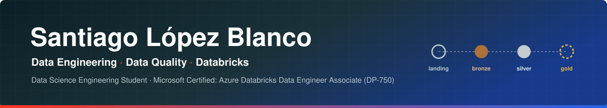

  

 

## About

Data Science Engineering student at Universidad Fidélitas, Costa Rica (GPA 95.92/100, coursework completion expected Aug 2027 and expected graduation Mar 2028). I build data pipelines on Databricks with PySpark, Delta Lake and Unity Catalog, with a focus on data quality: pipelines that validate data and fail fast instead of passing bad data downstream.

**Open to:** data engineering, data analytics and data science internships or entry-level roles · Costa Rica (GAM) or remote.

## Tech Stack

<table>
<tr>
<td valign="top" width="25%">

**Data Platform**

  
  
 

</td>
<td valign="top" width="25%">

**Languages & Data**

  
  
  
 

</td>
<td valign="top" width="25%">

**Machine Learning & Viz**

  
  
 

</td>
<td valign="top" width="25%">

**Engineering Practices**

  
  

</td>
</tr>
</table>

## Featured Projects

<table>
<tr>
<td width="50%" valign="top">

### Network Intrusion Data Pipeline (Kitsune)
**Databricks · Medallion Architecture · In progress**

Production-style pipeline over **2,771,276 network packets × 115 features** (UCI Kitsune, SYN DoS subset).

`landing → bronze → silver → EDA → gold (next)`

- Found a feature-extractor bug in a public benchmark: leaked Unix timestamps in the jitter features acted as a label shortcut (**99.6%** of leaked rows in the attack zone were attacks); removed the 10 affected features before training
- Hypothesis-driven EDA in PySpark: isolated a **2.68M-packet** attack-free training prefix and confirmed arrival order with window functions, supporting a chronological split
- Fail-fast quality gates: schema contract, row-count reconciliation, nulls, NaN/infinity, label domain
- Resolved a paper-vs-source-code conflict on column order by checking statistical invariants
- Unity Catalog governance, Delta liquid clustering, typed PySpark modules, PR-based Git

    

</td>
<td width="50%" valign="top">

### Warehouse & Retail Sales Forecasting
**Databricks · Medallion Architecture · Demand Forecasting**

End-to-end pipeline turning **307,645** U.S. government sales records into ML-ready Delta tables to forecast monthly product demand.

`bronze → silver → EDA → gold → model → dashboard`

- Compared 4 models with 5-fold time-series cross-validation and a 2020 (COVID) hold-out
- **LightGBM: R² 0.97 · MAE $279**, 23% below the linear baseline; registered in MLflow with its encoding artifacts
- Picked LightGBM over XGBoost despite a worse CV score: it degraded only **+$24** on unseen 2020 data vs. **+$192** for XGBoost
- Segment error analysis: identified KEGS (negative R²) and the March 2020 COVID shock as the model's limits
- Spark SQL aggregations cut data sent to pandas by **98.4%**

    

</td>
</tr>
<tr>
<td width="50%" valign="top">

### Customer Churn Prediction
**Python · Modular ML Pipeline**

Production-style pipeline for **7,043 telecom customers × 21 features**, covered by **8 pytest tests**.

`ingest → validate → transform → train → tune → evaluate`

- Schema and range validation of all 21 input columns before any processing
- Leakage-safe preprocessing: 70/15/15 split first, imputer fit on training data only
- Logistic Regression vs. Random Forest vs. tuned XGBoost (GridSearchCV) with decision-threshold optimization
- Best model (Logistic Regression): **AUC-ROC 0.85 · Recall 0.79**, prioritizing recall because missing a churner costs more than a false alarm
- EDA: month-to-month contracts churn at **42.7%** vs. **2.6%** for two-year contracts

   

</td>
<td width="50%" valign="top">

### Zara Sales EDA
**Python · Exploratory Data Analysis**

Retail analysis of **22.2M units** and **$884.6M** in revenue to find what drives sales by category.

`cleaning → concentration → promotions → price → seasonality`

- Jackets drive **55% of revenue**, **3.41×** the next category: a single-category concentration risk
- Ruled out promotions as the cause: promotion rates are flat across categories (40.5%–42.9%)
- Price sensitivity: moderate negative correlation between price and volume (**r = −0.34**)
- Seasonality: autumn is the peak season (7.99M units) and jackets lead in every season
- Business-oriented visual storytelling for non-technical readers

  

</td>
</tr>
</table>

## Certifications

| Certification | Issuer | Date |
|---|---|---|
| **Azure Databricks Data Engineer Associate (DP-750)** | Microsoft | Oct 2026 |
| Google Cloud Computing Foundations | Google Cloud | Sep 2026 |
| Get Started with Databricks for Machine Learning | Databricks Academy | Jun 2026 |
| Generative AI Fundamentals | Databricks Academy | May 2026 |
| Machine Learning Specialization | Stanford Online / DeepLearning.AI | May 2026 |
| Introduction to Python for DS & DE | Databricks Academy | Dec 2025 |
| Databricks Fundamentals | Databricks Academy | Nov 2025 |
| Introduction to Data Science | Cisco Networking Academy | Jun 2025 |
| Business Intelligence Foundation (BIFPC) | Certiprof | Jan 2025 |
| Business Agility (BAPC) · Scrum Foundation (SFPC) | Certiprof | Dec 2024 |

> To verify any credential, see the **Licenses & certifications** section of my [LinkedIn](https://www.linkedin.com/in/santiago-lopez-blanco-ds).

## Languages

**Spanish** — Native · **English** — B2, Cambridge Linguaskill

**Open to data engineering, analytics and data science opportunities.**

