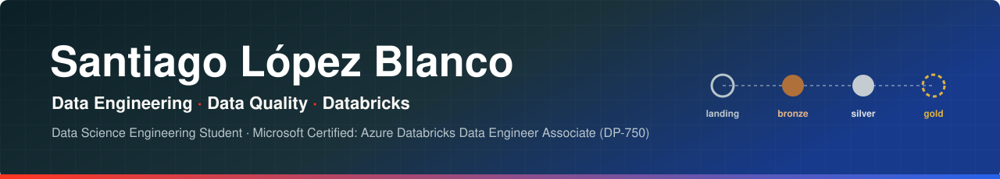

  

   

## About

Data Science Engineering student at Universidad Fidélitas, Costa Rica (GPA 95.9/100, expected graduation Oct 2027). I build data pipelines on Databricks with PySpark, Delta Lake and Unity Catalog, with a focus on data quality: pipelines that validate data and fail fast instead of passing bad data downstream.

**Open to:** data engineering, data analytics and data science internships or entry-level roles · Costa Rica (GAM) or remote.

## Tech Stack

<table>
<tr>
<td valign="top" width="25%">

**Data Platform**

  
  
 

</td>
<td valign="top" width="25%">

**Languages & Data**

  
  
  
 

</td>
<td valign="top" width="25%">

**Machine Learning & Viz**

  
  
 

</td>
<td valign="top" width="25%">

**Engineering Practices**

  
  

</td>
</tr>
</table>

## Featured Projects

<table>
<tr>
<td width="50%" valign="top">

### Network Intrusion Data Pipeline (Kitsune)
**Databricks · Medallion Architecture · In progress**

Production-style pipeline over **2,771,276 network packets × 115 features** (UCI Kitsune, SYN DoS subset).

`landing → bronze → silver → gold (next)`

- Fail-fast data quality gates: schema contract, file size, row-count reconciliation, nulls, NaN/infinity, label domain and a post-write check
- Resolved a paper-vs-source-code conflict on the order of 115 unnamed columns by checking statistical invariants in a single PySpark pass
- Unity Catalog governance (dev catalog, per-layer schemas, comments, tags), Delta tables with liquid clustering, typed PySpark modules, PR-based Git workflow

    

</td>
<td width="50%" valign="top">

### Warehouse & Retail Sales Forecasting
**Databricks · Demand Forecasting**

Bronze → Silver → Gold pipeline turning **307K** U.S. government sales records into ML-ready Delta tables to forecast monthly product demand.

`ingestion → cleaning → features → modeling → forecast`

- Compared 4 models with time-series cross-validation and a 2020 (COVID) hold-out
- **LightGBM: R² 0.97 · MAE $279**, 23% below the linear baseline; registered in MLflow
- Spark SQL cut data sent to pandas by **98.4%**

    

</td>
</tr>
<tr>
<td width="50%" valign="top">

### Customer Churn Prediction
**Modular ML Pipeline**

Pipeline for 7,043 telecom customers: validation, transformation, training, tuning and inference, covered by **8 pytest tests**.

- Leakage-safe preprocessing (imputer fit on training data only)
- Logistic Regression vs. Random Forest vs. tuned XGBoost with threshold optimization
- **AUC-ROC 0.85 · Recall 0.79**, prioritizing recall because missing a churner costs more than a false alarm

   

</td>
<td width="50%" valign="top">

### Zara Sales EDA
**Exploratory Data Analysis**

Retail analysis of **22.2M units** and **$884.6M** in revenue.

- Jackets drive **55% of revenue** without being promoted more than other categories, a single-category concentration risk
- Business-oriented visual storytelling for non-technical readers

  

</td>
</tr>
</table>

## Certifications

| Certification | Issuer | Date | Verify |
|---|---|---|---|
| **Azure Databricks Data Engineer Associate (DP-750)** | Microsoft | Oct 2026 | [Credential](https://learn.microsoft.com/api/credentials/share/es-mx/SantiagoLpezBlanco-2204/6BC60448E3684F2?sharingId=E76EF72697970AEE) |
| Google Cloud Computing Foundations | Google Cloud | Sep 2026 | [Credly](https://www.credly.com/badges/95a2dbda-fc95-4b11-be71-15df1b7b03b5/public_url) |
| Get Started with Databricks for Machine Learning | Databricks Academy | Jun 2026 | [Wallet](https://credentials.databricks.com/profile/santiagolpezblanco626690/wallet) |
| Generative AI Fundamentals | Databricks Academy | May 2026 | [Credential](https://credentials.databricks.com/77d2610b-0e6e-459f-ac92-d63373e33760#acc.Cc0L3UPG) |
| Machine Learning Specialization | Stanford Online / DeepLearning.AI | May 2026 | [Coursera](https://www.coursera.org/account/accomplishments/specialization/EGLC12RFQOIY) |
| Introduction to Python for DS & DE | Databricks Academy | Dec 2025 | [Credential](https://credentials.databricks.com/78bb0747-02bc-4b2c-b4b3-a6f236b3e3f7?username=santiagolpezblanco626690) |
| Databricks Fundamentals | Databricks Academy | Nov 2025 | [Credential](https://credentials.databricks.com/c719f1f7-b09d-4200-82bd-655af8a58746) |
| Introduction to Data Science | Cisco Networking Academy | Jun 2025 | [Credly](https://www.credly.com/badges/23d5627c-938d-4be2-afa9-453274165685/public_url) |
| Business Intelligence Foundation (BIFPC) | Certiprof | Jan 2025 | [Credly](https://www.credly.com/earner/earned/badge/d72c334d-9f7e-48f8-af2e-0cbc9012a40b) |
| Business Agility (BAPC) · Scrum Foundation (SFPC) | Certiprof | Dec 2024 | [BAPC](https://www.credly.com/earner/earned/badge/54dcaaf5-5829-4173-a37e-458890afb7af) · [SFPC](https://www.credly.com/earner/earned/badge/c8bd637e-2e65-4361-8123-c5ba4f1ca447) |

## Languages

**Spanish** — Native · **English** — B2, Cambridge Linguaskill 

**Open to data engineering, analytics and data science opportunities.**

 

